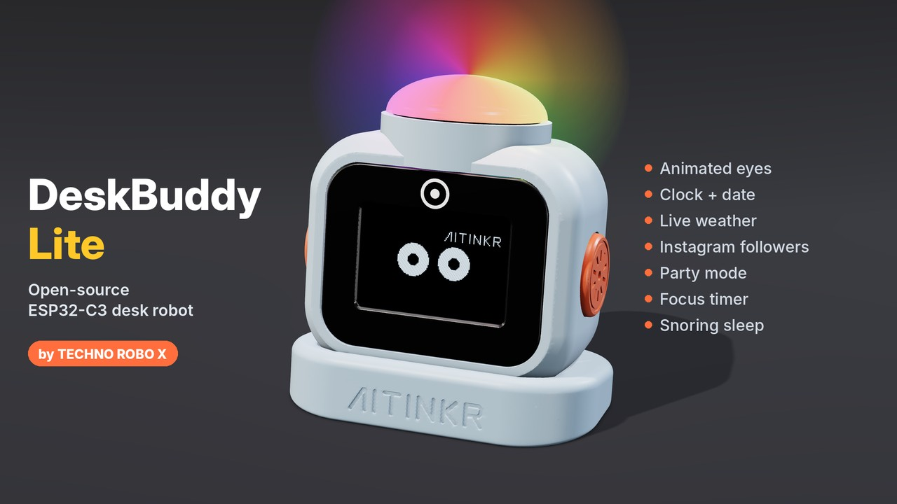
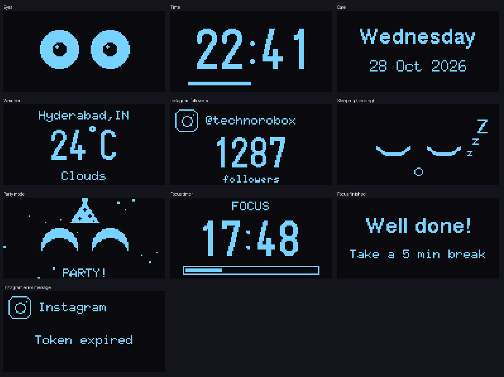

# DeskBuddy Lite 🤖  — by TECHNO ROBO X


<sub>Pictured: the full DeskBuddy build with its 3D-printed case. The Lite code runs on the same XIAO + OLED + touch pad.</sub>

A tiny desk robot with **animated eyes**, a **clock**, the **date**, live **weather**, a live
**Instagram follower counter**, **party mode**, a **focus timer** and a **snoring sleep mode** —
on a XIAO ESP32-C3 and a 1.3" OLED.

▶ Full build video: https://youtu.be/4eB-Sj1Lqx8
📺 More builds: **TECHNO ROBO X** on YouTube

> This is the free **Lite** version.

---

## 🖥️ What it shows


## 🧰 Parts
| Part | Notes |
|---|---|
| Seeed Studio XIAO ESP32-C3 | with the Wi-Fi antenna attached |
| 1.3" OLED, SH1106, 128×64, I²C | 4 pins: VCC GND SCL SDA |
| TTP223 touch module | tap to change screens |
| Active buzzer 12 mm *(optional)* | beeps for taps, party and focus |
| Breadboard + jumper wires, USB-C cable | |

## 🔌 Wiring
| From | To XIAO |
|---|---|
| OLED VCC / GND | 3V3 / GND |
| OLED SDA | **D4** |
| OLED SCL | **D5** |
| TTP223 VCC / GND | 3V3 / GND |
| TTP223 I/O | **D1** |
| Buzzer + / – *(optional)* | **D6** / GND  (no buzzer? set `USE_BUZZER 0`) |

## 💻 Arduino IDE setup
1. **Boards Manager** → install **esp32 by Espressif** → board **XIAO_ESP32C3**
2. **Library Manager** → install **U8g2** (olikraus) and **ArduinoJson**
3. Download this repo (**Code → Download ZIP**), open `DeskBuddy_Lite/DeskBuddy_Lite.ino`, fill in **`secrets.h`**, click **Upload**
4. Use the touch pad:

| Touch | What happens |
|---|---|
| **Tap** | next screen: Eyes → Time → Date → Weather → Instagram (they also flip by themselves every 6 s) |
| **Hold 1.5 s** | 🎉 **Party mode** for 30 s — party hat, happy eyes, confetti |
| **Hold 3 s** | ⏱️ **Focus timer** 25 min (tap = stop). Says *Well done!* at the end |
| *(leave it alone 2 min)* | 😴 **Falls asleep and snores** — tap to wake it up |

A little bar at the bottom shows what your hold will do — let go when it says what you want.

---

## 🌦️ Step 1 — Free weather API key (OpenWeatherMap)
1. Sign up at **openweathermap.org** (free plan).
2. Open your profile → **My API keys** → copy the key.
3. Paste it into `OWM_API_KEY` and set `OWM_CITY` like `"Mumbai,IN"` (no spaces).
4. ⏳ A brand-new key can take **up to ~2 hours** to start working. Until then the screen says *Bad API key*.

---

## 📸 Step 2 — Instagram follower counter (Meta Graph API)

**Your Instagram must be a Professional account (Creator or Business).**
Personal accounts — public or private — cannot be read by the API.
Switch in the Instagram app: *Settings → Account type and tools → Switch to professional account*.

There are two ways. Pick one:

### Option A — Show **your own** followers  (token starts with `IGAA…`)
1. Go to **developers.facebook.com** → *My Apps* → **Create App**.
2. Choose the Instagram use case (*"Manage messaging & content on Instagram"* / *Instagram API with Instagram Login*).
3. In the app's Instagram settings, **add your Instagram account** and **generate an access token**.
4. Paste it into `IG_TOKEN`. Leave `IG_TARGET` empty.
5. This token lasts **60 days**. Make a new one before it runs out (or when the screen says *Token expired*).

### Option B — Show **any** Business/Creator account  (token starts with `EAA…`)
This uses Meta's **Business Discovery**: your account looks up another professional account's public numbers.
1. Create a **Facebook Page** and **link your Instagram** professional account to it
   (Instagram → Settings → Accounts Center / Page settings → Linked accounts).
2. Create an app at **developers.facebook.com** (Business type).
3. Open **Graph API Explorer**, select your app, click **Generate Access Token** and allow:
   `pages_show_list`, `instagram_basic`, `business_management` (and `pages_read_engagement` if asked).
   Make sure you tick your **Page** when it asks.
4. (Recommended) Turn it into a **long-lived token** with the *Access Token Debugger → Extend Access Token*.
5. Paste it into `IG_TOKEN`, and put the account to show into `IG_TARGET` (just the username, no `@`).
   The target must also be a **Business or Creator** account.

How it works in the code:
```
GET graph.facebook.com/me/accounts            → finds your Page + linked Instagram id
GET graph.facebook.com/<your-ig-id>?fields=business_discovery.username(TARGET){username,followers_count}
```

### 🛠️ What the screen messages mean
| Message | Fix |
|---|---|
| `Add IG token` | `IG_TOKEN` in secrets.h is empty |
| `Token expired` | make a new token (Option A: every 60 days) |
| `Not a Business/Creator acct` | the account (yours or `IG_TARGET`) must be Professional |
| `Link Instagram to a FB Page` | Option B needs your Instagram linked to a Facebook Page |
| `Permission missing` | regenerate the token with the permissions listed above |
| `Rate limited` | too many requests — it retries by itself in 15 minutes |

---

## 🔒 Keep your keys safe
`secrets.h` holds your Wi-Fi password and tokens. **Never post it** on GitHub, YouTube or in comments.
If a token leaks, delete it / generate a new one in the Meta developer dashboard.

## 📄 License
MIT — free to use, change and share. A shout-out to **TECHNO ROBO X** is appreciated! 🙌
